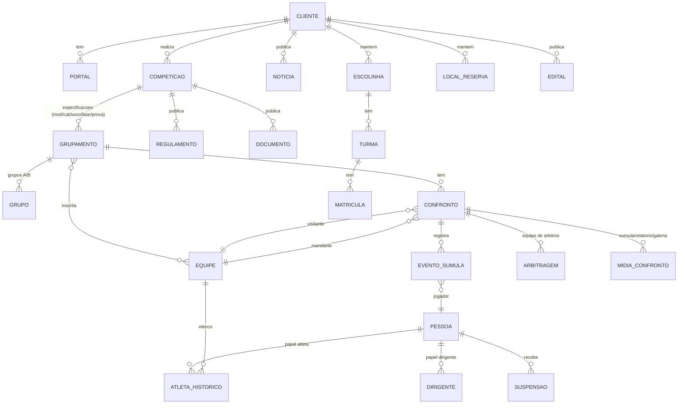

# Mapeamento do Portal GDC (portal público de uma entidade): `esporteregistrosp.portalgdc.com.br`

Complemento do mapeamento do GDC Arena. Este é o **"Portal de Informações"** público (o que o torcedor vê), operado pela Secretaria Municipal de Esporte e Lazer de Registro (SP).

**Como foi coletado:** navegação real no Chrome (home, competições, jogos, classificação, partida, equipes, artilharia, disciplina, suspensos, regulamentos, documentos, programação), leitura do JavaScript público do portal (`app.js`, `api.js`) e leitura das respostas das rotas públicas `GET /public/*`. Nada foi criado, editado ou enviado, e **não houve login**. Nomes de atletas e dirigentes foram **omitidos** deste documento (aparecem como `<nome>`). Nomes de clubes e de competições foram mantidos porque são públicos e institucionais.

Data da coleta: 12/10/2026. Legenda: **CONFIRMADO** (visto em tela, rede ou código), **DEDUÇÃO**, **NÃO VERIFICADO**.

## Índice
1. Visão geral e stack
2. Mapa de navegação e rotas
3. Telas do portal, uma a uma
4. Partida, elenco, equipe e atleta (detalhe)
5. Regras de competição (exemplo real: Regulamento Técnico)
6. API pública (endpoints e formato)
7. Área da pessoa e gestão de equipes (só pelo código, sem login)
8. Modelo de dados deduzido
9. UX, pontos fortes e fricções
10. Oportunidades (inclui OBS) e riscos
11. Checklist do que não foi verificado
- Resumo executivo

---

## 1. Visão geral e stack

| Item | Resultado |
|---|---|
| Produto | Portal GDC, versão pública e multi-cliente (multi-tenant) do sistema GDC Arena |
| Cliente observado | Secretaria Municipal de Esporte e Lazer de Registro (SP), identificador interno de cliente 490 |
| Domínio por cliente | **CONFIRMADO:** subdomínio `<nome_portal>.portalgdc.com.br`. O front pergunta à API `GET /public/portal-por-nome/esporteregistrosp` quem é o cliente |
| Front-end | **CONFIRMADO:** SPA em JavaScript puro (sem framework). Arquivos `js/config.js`, `js/api.js`, `js/app.js`, `js/a11y.js`; `css/styles.css`, `css/a11y.css`. Rotas por hash (`#/rota`) |
| Back-end | API REST em `https://api.portalgdc.com.br` (JSON). Linguagem **NÃO VERIFICADO** (comentários do código citam "Delphi" e `uServer.pas`, ou seja, **DEDUÇÃO**: servidor em Delphi) |
| Imagens | `https://imagensgdc.portalgdc.com.br` (pastas `/logos`, `/fotos`, `/icones`, `/portalgdc`, `/midiassumulas`) |
| Infra | Cloudflare (RUM, Insights). Fontes Sora e Inter (Google Fonts) |
| Tema | **CONFIRMADO:** cor da marca vem da API (`COR_ACENTO`) e o front deriva a segunda cor; há modo escuro (botão de tema); favicon e logo por cliente |
| Acessibilidade | **CONFIRMADO:** botão "Acessibilidade" fixo, `a11y.js` e `a11y.css` dedicados |
| Tempo real | Faixa de jogos no topo (ticker) e cartão "Próximo confronto". Rótulo "TEMPO REAL", porém **sem WebSocket/SSE**: só `fetch` com cache de 60 s. **CONFIRMADO** no código |
| Concorrência | O cliente limita a 8 requisições simultâneas e cacheia GET por 60 s (proteção contra rate-limit). **CONFIRMADO** |

Observação de configuração por cliente (flags `VER_*`): cada entidade liga ou desliga áreas do portal. Neste cliente o menu superior mostra só **Início** e **Competições**; Notícias, Agenda, Galerias, Escolinhas, Reservas e outras estão desligadas ou vazias, mas as rotas existem. Isso é um recurso do produto: **menus controlados por configuração do cliente**.

---

## 2. Mapa de navegação e rotas

**Menu superior (neste cliente):** Início | Competições | botão tema (claro/escuro) | Entrar. Menu padrão do produto: Início, Agenda Institucional, Notícias, Competições (itens somem conforme `VER_*`).

**Barra de contexto (aparece abaixo do menu em telas de competição):**
```
[Seletor de competição ▾ + ano]   [Modalidade ▾ com ícone]
Categoria em abas  (SUB-09 | SUB-11 | SUB-13 | SUB-15 | SUB-17 ...)
Sexo (Masculino/Feminino/Misto)  +  Fase (Fase 01, 02, ...)
```
Em cada tela, a barra é ocultada ou reduzida conforme o tipo de página (regra `SUB_OCULTA` / `SUB_SO_COMP` no código).

**Rotas de hash (CONFIRMADO no código; as marcadas ✔ também foram abertas no navegador)**

| Rota | Tela | Visto |
|---|---|---|
| `#/inicio` | Home (hero, jogos, classificação, medalhas, notícias, modalidades, "Explore o portal", apoiadores) | ✔ |
| `#/competicoes` | Lista de competições (cards com capa e logo) | ✔ |
| `#/jogos` | Jogos e Resultados (filtro Todos/Próximos/Encerrados + Imprimir) | ✔ |
| `#/agenda` | Programação (jogos agendados por competição e modalidade, imprimível) | ✔ |
| `#/agendainst` | Agenda Institucional (eventos da Secretaria) | só código |
| `#/classificacao` | Classificação por grupo, com filtro de fase e Imprimir | ✔ |
| `#/chaveamento` | Grupos / Chaves | só código |
| `#/modalidades` | Grade de modalidades da competição | ✔ |
| `#/equipes` | Equipes confirmadas na competição | ✔ |
| `#/equipe/:cdEquipe[/:idGrupamento]` | Hub da equipe (abas Jogos, Disciplina, Suspensos) | ✔ |
| `#/confronto/:id` | Detalhe da partida (abas Eventos, Elenco, Informações) | ✔ |
| `#/confronto/:id/sumula` | Súmula e relatório online | só código |
| `#/atleta/:idGrupamento/:cdAtleta` | Perfil do atleta | só código (dados pessoais; não aberto) |
| `#/artilharia` | Artilharia | ✔ |
| `#/cestinhas` | Cestinhas (basquete; sem dados em futebol) | ✔ ("Sem dados") |
| `#/defesa` | Defesa menos vazada | só código |
| `#/disciplina` | Cartões por equipe | ✔ |
| `#/destaques` | Destaques | só código |
| `#/suspensos` | Suspensos (4 seções) | ✔ |
| `#/medalhas` | Quadro de medalhas (só quando há dado) | só código |
| `#/noticias`, `#/noticia/:id` | Notícias | só código |
| `#/galeriaimg`, `#/galeriavid` | Galerias de imagens e vídeos | só código |
| `#/regulamentos` | Regulamentos (HTML expansível por competição) | ✔ |
| `#/documentos` | Documentos públicos (PDFs com "Abrir") | ✔ |
| `#/escolinhas` | Escolinhas (3 níveis: lista, turmas, detalhe) | só código |
| `#/editais`, `#/edital/:id` | Editais públicos | só código |
| `#/reservas` | Reservas de locais ("Nenhum local disponível" neste cliente) | ✔ |
| `#/conta` | Área da pessoa (login: "Acesse sua conta", Criar conta, Esqueci minha senha, "É organizador? Acessar o Gerenciamento") | ✔ |
| `#/competicao/:id`, `#/grupamento/:comp/:grup` | Links diretos (hub com grade de opções do grupamento) | só código |

---

## 3. Telas do portal, uma a uma

### 3.1 Home (`#/inicio`)
- **Ticker** no topo com últimos resultados e próximos jogos (até 8 + 6), animação contínua.
- **Hero:** nome da competição ativa, rótulo "Futsal · SUB-09 · MF · 01" (modalidade, categoria, sexo, fase), 3 números (modalidades, competições, equipes) e **cartão "Próximo confronto"** (ou "Último resultado") com escudos, horário, data e local; clicável.
- **Jogos e Resultados:** carrossel horizontal de cards (status "Agendado" ou "Encerrado").
- **Classificação:** top 5 + link "Tabela →". **Quadro de medalhas** (só se houver).
- **Notícias** (matriz com destaques) e **Modalidades** (até 12 ícones).
- **"Explore o portal":** atalhos para todas as áreas liberadas (Jogos & Resultados, Programação, Classificação, Competições, Grupos/Chaves, Equipes, Artilharia, Defesa, Disciplina, Destaques, Galerias, Regulamentos, Documentos Públicos, Escolinhas, Minha Conta). Estatísticas só aparecem se a modalidade as tiver.
- **Apoio e Patrocínio:** carrossel de logos (corte automático de margem branca por canvas). Sem apoiadores, mostra ícones de modalidades como padrão.
- Rodapé: órgão, endereço, telefone e redes sociais, se configurados.

### 3.2 Competições (`#/competicoes`)
6 competições neste cliente, todas "2026", da Secretaria: Futebol Amador 1ª Divisão; Futebol Amador 2ª Divisão; Futebol Quarentão; Futebol Veteranos; Futsal Amador; Futsal de Base. Cada card tem capa de divulgação, logo, nome, realização, ano e período. Clique = abre a competição (vai a Classificação). Ordenação: ano decrescente, depois nome.

Dado observado: uma competição exibe período "09/03/2026 A 12/06/2025" (fim antes do início) e outra tem "LAZEER" na realização. **Falhas de qualidade de dado cadastrado** (campo de texto livre, sem validação).

### 3.3 Jogos e Resultados (`#/jogos`)
Filtros: Todos, Próximos, Encerrados. Botão **Imprimir** abre uma folha formatada ("Programação (Modelo 1)": logo, competição, faixa data + dia + local, tabela com Nº do jogo, horário, confronto e sufixo grupo-gênero-categoria). Card: modalidade, status, escudos, nomes, placar (só se o jogo foi realizado), data, hora, local. Regra de negócio: jogo agendado nunca mostra "0 x 0".

### 3.4 Classificação (`#/classificacao`)
- Abas de fase: **Geral** (fase de grupos) e cada **Fase N**.
- **Fase de grupos é dividida em "Grupo A/B/..."** (vem do dado `cd_grupo`/`grupo_nome`).
- Colunas mudam conforme o `TIPORESULTADO` da modalidade (CONFIRMADO no código):

| Tipo | Modalidades | Colunas |
|---|---|---|
| 1 gols | futebol, futsal, handebol | Pts, J, V, GP, GC, SG |
| 2 sets | vôlei | SP, SC, SS, PP, PC, SPT |
| 3 pontos | outras | PP, PC, SPT (bocha: + BP, BC, SB) |
| 4 performance | individuais | Atleta, Pts, ouro, prata, bronze |

- Linha da equipe é clicável (vai ao hub da equipe). Botão **Imprimir** (A4 retrato, todos os grupos).

### 3.5 Estatísticas
- **Artilharia:** ranking (posição, iniciais/foto, nome, equipe, "N gols"), até 15. Existe em modalidades de gols.
- **Disciplina (Cartões):** tabela por equipe com Amarelos, Vermelhos, Azuis e Total; ordem fair-play (menos vermelhos, depois amarelos, depois azuis). Exemplo real: equipe com 12 amarelos, 1 vermelho, 0 azul, total 13.
- **Suspensos:** 4 seções (Atletas × Cartões, Atletas × Julgamento, Dirigentes × Cartões, Dirigentes × Julgamento). Mostra motivo (inclusive o texto da decisão do tribunal disciplinar), "até dd/mm" ou "Faltam N jogos".
- **Defesa** e **Destaques:** existem no código; basquete tem "Cestinhas".
- Quais estatísticas aparecem depende da modalidade (gols = artilharia + defesa + disciplina + destaques; basquete e vôlei = disciplina + destaques).

### 3.6 Regulamentos e Documentos
- **Regulamentos:** lista por competição (Regulamento Geral, Regulamento Disciplinar, Regulamento Técnico); clicar abre o **HTML do regulamento** na própria página (sanitizado). É onde a competição publica as regras, que são texto livre, não campos configuráveis.
- **Documentos públicos:** árvore de pastas e arquivos (nome, tipo "PDF", tamanho em KB, botão "Abrir"). Exemplo: 3 PDFs de regulamentos entre 532 e 659 KB.

### 3.7 Programação (`#/agenda`)
Agrupada por competição ("20 jogos"), com cards que mostram modalidade, **etiquetas de categoria, sexo e fase**, equipes, data, hora e local. Suporta **prova individual** (sem segunda equipe). Botão Imprimir.

### 3.8 Outras áreas (código)
Agenda Institucional (eventos por tipo e período, só se a flag ligar), Notícias (leitura com HTML sanitizado), Galeria de Imagens e de Vídeos (lightbox/embed), Escolinhas (lista, turmas com idade, local, professor, vagas e período de inscrição), Reservas de Locais, Editais (vitrine pública com anos, abertos e arquivados, e detalhe com documentos exigidos).

---

## 4. Partida, elenco, equipe e atleta

### 4.1 Detalhe da partida (`#/confronto/:id`)
**Cabeçalho:** botão "← Voltar", nome da competição, linha "Modalidade · Categoria · Sexo · data hora", escudos, **placar**, selo de status (**Encerrado / Ao vivo / Agendado**), local, "Parciais" (sets). Os escudos levam à equipe.

Status é **calculado no cliente**: `status=1` ou texto "FINALIZ/ENCERR" = encerrado; começou há menos de 3 h = **ao vivo**; senão agendado ou encerrado.

**Aba Eventos:** linha do tempo por **período** ("Período 1º", "Período 2º") com tempo ("17:00"), ícone, tipo e jogador e equipe. Exemplo de uma partida 7 x 0: 11 eventos, com tipos gol (1), cartão amarelo (3) e cartão vermelho (4). Catálogo de tipos no código (`cdTipo`): 1 gol, 2 gol contra, 3 amarelo, 4 vermelho, 5 azul, 7 destaque, 14/15/16 cestas de basquete (3, 2, lance livre), 17 a 22 bocha e boliche, 23/24 entra/sai, 25 tempo técnico, 26/27 líbero, 28/29 desafio aceito/recusado, 32 advertência, 101 substituição (2 linhas: entra ↓ e sai ↑), 200/201 início/fim de período. A substituição mostra número e nome de quem entra e de quem sai.

**Aba Elenco:** dois **acordeões** (equipe 1 aberta, equipe 2 recolhida) com contagem. Cada linha: foto (ou ícone padrão), nome, número da camisa (`#N`), função ("Atleta", "Técnico", "Aux. técnico", "Massagista"...), selo de **suspensão** (ex.: "SUSP. JULGAMENTO") e situação na súmula ("EM SÚMULA" ou "AUSENTE"). Atletas e dirigentes (comissão técnica) são listados juntos. Exemplo real de dimensão: 21 atletas e 4 dirigentes numa equipe, 22 atletas e 3 dirigentes na outra. Atleta clicável abre o perfil. **Respeita a flag `EXIBIR_ATLETAS_EQUIPES`**: com valor 0 a aba "Elenco" some do portal inteiro.

**Aba Informações:** 4 linhas fixas (ficam desabilitadas sem fonte): Transmissão ao vivo (link), Súmula do jogo (imagem), Relatório da súmula (imagem), **Súmula e relatório online** (digital); depois "Mídias do confronto" (galeria com lightbox) e quadro de **Arbitragem** (nome, função, federação, foto). Neste jogo, mídias e arbitragem vieram vazias.

### 4.2 Súmula online (`#/confronto/:id/sumula`)
Só abre para jogo realizado (erro 403 para jogo não realizado). Reúne cabeçalho, relação por equipe, todos os lances, **Relatório** (horário de encerramento, relatantes, relatados, ocorrências, "Não houve ocorrências") e arbitragem.

### 4.3 Hub da equipe (`#/equipe/:cd`)
Cabeçalho com escudo, nome e competição; 3 abas:
- **Jogos:** um card por especificação (modalidade, categoria, sexo, fase), com **posição ("10º lugar"), pontos, jogos, vitórias e % de aproveitamento**, mais os jogos da equipe e link "Classificação →".
- **Disciplina:** totais da equipe (amarelos, vermelhos, azuis) e, se a flag permitir, tabela por atleta (gols, destaques, cartões, suspensões).
- **Suspensos:** lista da equipe por modalidade.
Os dados de cada card carregam **sob demanda** (IntersectionObserver, fila de 2 simultâneos e cache) para evitar excesso de requisições.

### 4.4 Perfil do atleta (`#/atleta/:grup/:cd`)
**Só código** (por conter dados pessoais não foi aberto): identidade (nome, apelido, equipe, data de nascimento, foto), contadores (jogos, gols, destaques, amarelos, vermelhos, azuis, suspensões) e **histórico jogo a jogo** (adversário, placar V/E/D, gols e cartões por jogo).

---

## 5. Regras de competição (exemplo real: Regulamento Técnico da 1ª Divisão de Futebol Amador 2026)

As regras abaixo são **texto de regulamento publicado**, ou seja, são configuradas pela entidade, não são fixas no sistema. Servem como exemplo numérico de uma competição real.

| Tema | Regra (resumo fiel) |
|---|---|
| Formato | 12 equipes, 4 fases: 1ª fase em 2 grupos de 6 (turno único), quartas, semifinal e final em jogo único; cada equipe joga de 5 a 8 partidas |
| Cabeças de chave | Pela classificação do ano anterior; demais por sorteio no congresso técnico |
| Classificação | Os 4 melhores de cada grupo vão às quartas; **os 2 piores de cada grupo são rebaixados** à 2ª Divisão |
| Quartas | 1ºA x 4ºB, 2ºA x 3ºB, 1ºB x 4ºA, 2ºB x 3ºA; melhor campanha é mandante. Semifinal: vencedores QF1xQF3 e QF2xQF4 |
| Pontuação | Vitória 3, empate 1, derrota 0 |
| Desempate (grupos), em ordem | 1) mais vitórias; 2) maior saldo de gols; 3) mais gols marcados; 4) confronto direto (só entre duas equipes); 5) menos vermelhos; 6) menos amarelos; 7) sorteio público |
| Mata-mata empatado | Pênaltis: 5 cobranças alternadas por equipe; persistindo, alternadas por atletas diferentes até decidir |
| Melhor campanha | Pontos acumulados só do tempo regulamentar; empate usa os mesmos critérios de desempate |
| Duração | 90 min (2 x 45) com intervalo de 15 min; parada de hidratação de até 2 min por tempo (~22' e ~67') |
| Relação de jogo | 11 titulares, 11 reservas e 3 da comissão técnica; atleta pode ser também comissão (e vice-versa) com regras de troca de função antes do 1º ou 2º tempo |
| Substituições | Até 8 por jogo, em no máximo 3 "atos" de substituição; intervalo não conta como ato; quem sai não volta |
| Condição de jogo | Inscrição online, documentação entregue e validada; prazos (1ª rodada até 10/04/2026 17h; rodadas seguintes até 17h da quarta anterior; feriado: penúltimo dia útil); título de eleitor para comprovar domicílio no município (maiores de 18) |
| Troca de atleta | Pedido de exclusão no sistema, área "Solicitações" (nome, RG, CPF); exclusão só vale após confirmação da organização; atleta que já jogou por uma equipe não pode jogar por outra na mesma edição |
| Suspensão automática | **3 amarelos = 1 jogo de suspensão**; vermelho = 1 jogo, sem prejuízo do tribunal; regras para amarelo seguido de vermelho (3º amarelo + vermelho = 2 impedimentos; 2 amarelos no mesmo jogo não contam para a série) |
| Zerar cartões | Ao fim da 1ª fase os amarelos são zerados (exceto o 3º recebido na última partida da fase); vermelhos e penas do tribunal (CDD) não zeram |
| Suspensão e W.O. | Jogo suspenso: cumprir na partida integral seguinte; adiado: na seguinte; **W.O. na partida seguinte considera a pena cumprida**; fim da competição também |
| Desistência / exclusão | Rebaixamento; jogos já feitos valem; os não disputados são **W.O. a favor dos adversários**; em mata-mata o adversário avança |
| Arbitragem | Contratada pela Secretaria; escala sem direito de veto das equipes |

Pontos de regra de sistema que isso revela para quem for reconstruir: critérios de desempate configuráveis em ordem, suspensão automática por série de cartões com exceções, zeramento por fase, W.O., rebaixamento, condição de jogo por data limite e documentos, e relação de jogo com limites de titulares, reservas e comissão. **NÃO VERIFICADO** se esses parâmetros são campos configuráveis no painel ou lógica fixa.

---

## 6. API pública (endpoints e formato)

Base: `https://api.portalgdc.com.br`. Todas as chamadas do portal anônimo são `GET`, JSON, **sem autenticação**, e passam por fila (8 simultâneas) com cache de 60 s. `cdCliente` do cliente observado = 490.

| Rota | Retorno (resumo) |
|---|---|
| `/public/portal-por-nome/{nome}` | Config do portal: `ID_PORTAL`, `CDCLIENTE`, `ORGAO`, `CIDADE`, `ESTADO`, `LOGO`, `COR_ACENTO`, `FACEBOOK`, `INSTAGRAM`, `TELEFONE`, `ENDERECO`, `CEP`, `COMPETICAO_PADRAO`, `INFO_CABECALHO`, `EXIBIR_ATLETAS_EQUIPES`, flags `VER_NOTICIAS`, `VER_AGENDA`, `VER_AGENDA_INST`, `VER_ESCOLINHAS`, `VER_COMPETICOES`, `VER_GALERIAIMAGENS`, `VER_GALERIAVIDEOS`, `VER_SUSPENSOES`, `VER_CONTAUSUARIO`, `VER_RESERVAS` |
| `/public/portal/{idPortal}` | Mesmo contrato, por id |
| `/public/competicoes/{cd}` | `CDCOMPETICAO`, `COMPETICAO`, `ANOCOMPETICAO`, `PERIODOCOMPETICAO`, `LOGO1`, `LOGODIVULGACAO`, `REALIZACAO` |
| `/public/grupamentos/{cd}/{comp}` | Especificações da competição: `CDGRUPOSORTEADO`, `MODALIDADE`, `CATEGORIA`, `SEXO`, `FASE`, `PROVA`, `ICONE`, `TIPORESULTADO`, `CLASSESUMULA`, `NEQUIPES`, `NGRUPOS` |
| `/public/resultados/{idGrup}` e `/public/proximosconfrontos/{idGrup}` | Jogos: `EQUIPE1/2`, `LOGO1/2`, `R1/R2`, `DATA`, `HORA`, `LOCAL`, `MODALIDADE`, `CDCONFRONTO`, `cd_grupo`, `cd_equipe1/2`, `JOGON`, `JOGON_ORDENAR`, `GRUPO` |
| `/public/grupamentos/classificacao/{idGrup}/{S\|N}[?aplicarFase=N&aplicarTipoSorteio=N]` | Linhas de classificação por tipo de resultado; `S` agrega, `N` mantém o grupo (`cd_grupo`, `grupo_nome`) |
| `/public/grupamentos/resumotecnico/{idGrup}` | Grupos separados: `cd_grupo`, `grupo`, `equipes[]`, `jogos[]` (matriz) |
| `/public/grupamentos/estatisticas/{idGrup}/{artilharia\|defesa\|disciplina\|destaques}` | Ranking: `atleta`, `equipe`, `gols/pontos/quantidade`, `ca/cv/caz`, `cd_atleta`, `cd_equipe`, `foto` |
| `/public/confronto/historico/{id}` | `placar{r1,r2,equipe1,logo1,equipe2,logo2,status,parciais,data,hora,disputa,modalidade,categoria,sexo,cdCliente,local,competicao,cd_equipe1,cd_equipe2,cd_grupo}`, `eventos[{tempo,periodo,descricao,cdTipo,nome,cd_atleta,equipe,valor,nomeSecundario,nrEntra,nrSai,seq}]`, `periodoEventos{inicio1p,termino1p,inicio2p,termino2p,pextra,terminopextra}` |
| `/public/confronto/equipes/{id}` | `equipe1/equipe2{atletas[{cd_atleta,nome,foto,numero,funcao,status,relacionado_sumula}],dirigentes[{nome,foto,funcao,status}]}`, `cd_grupo` |
| `/public/confronto/midias/{id}` | `link_transmissao`, `sumula_jogo`, `relatorio_sumula`, `galeria[]` |
| `/public/confronto/arbitragem/{id}` | `arbitragem[{nome,funcao,federacao,foto}]` |
| `/public/confronto/{id}/relatorio` | Relatório da súmula (403 se não realizado) |
| `/public/equipes/{cd}/{comp}` | Equipes confirmadas: `CDEQUIPE`, `EQUIPE`, `LOGOEQUIPE` |
| `/public/equipe-grupamentos/{cd}/{comp}/{cdEquipe}` | Especificações da equipe |
| `/public/equipe-disciplina/{idGrup}/{cdEquipe}` | Disciplina por atleta |
| `/public/atleta-perfil/{idGrup}/{cdAtleta}` | `identidade`, `estatisticas`, `historico[]` |
| `/public/suspensos/{idGrup}` | `papel`, `tipo`, `nome`, `equipe`, `foto`, `fim`, `faltam`, `motivo`, `cd_pessoa`, `cd_equipe` |
| `/public/medalhas/{comp}` | Quadro: `equipe`, `logo`, `ouro`, `prata`, `bronze`, `total`, `cd_equipe` |
| `/public/noticias/{cd}`, `/public/videos/{cd}`, `/public/galeria/{cd}`, `/public/apoiadores/{cd}` | Conteúdo do cliente |
| `/public/agenda/{cd}`, `/public/agenda-institucional/{cd}[?passados=1&tipo=&de=&ate=]` | Programação e eventos institucionais (`exibir_secao` liga/desliga) |
| `/public/regulamentos?cdCompeticao=` | `titulo`, `Regulamento` (HTML) |
| `/public/documentos/{comp}[?path=]` | `nome`, `tipo`, `tamanho`, `url` |
| `/public/escolinhas-lista/{cd}`, `/public/escolinha-turmas/{cd}/{esc}`, `/public/reserva-locais/{cd}`, `/public/editais?cliente=&ano=`, `/public/editais/{id}?cliente=`, `/public/estados`, `/public/cidades/{uf}` | Escolinhas, reservas, editais e tabelas auxiliares |

**Exemplo reduzido (real, sem pessoas):** resposta de `/public/confronto/midias/{id}` = `{"galeria":[]}`; de `/public/confronto/arbitragem/{id}` = `{"arbitragem":[]}`.

Rede: carga inicial da home = ~48 requisições, das quais ~16 chamadas à API. Um arquivo de logo respondeu 503 (imagem pontual). Não há WebSocket, SSE nem polling em intervalo: a atualização depende de recarregar ou navegar (**CONFIRMADO**).

---

## 7. Área da pessoa e gestão de equipes (só pelo código, sem login)

Existe no `api.js` um grande conjunto de rotas autenticadas por **token Bearer** (login por CPF ou e-mail e senha). **Não foram chamadas.** Servem para dimensionar o produto:

- **Conta:** `/conta/login`, criar conta (CPF, validação de CPF na Receita Federal com consumo de crédito, nascimento, e-mail, celular, senha, nome da mãe, código OTP de confirmação), esqueci e redefinir senha, ativação manual, meus dados, foto (≤ 4 MB), documentos privados (jpg/png/bmp/pdf, 10 MB), **excluir conta (LGPD, confirma digitando "EXCLUIR")**, localidade.
- **Inscrições da pessoa:** inscrição individual, em dupla (CPF do parceiro) e por equipe; competições abertas; campos exigidos por especificação; ficha de saúde **PAR-Q** com questionário, atestado e selo.
- **Gestão de equipes (gestor/dirigente):** listar equipes e competições, elenco por especificação, inscrever e remover atleta, buscar atleta existente, cadastrar pessoa nova, validar CPF, número da camisa, solicitar liberação de atleta, funções liberadas, inscrever dirigente, **credenciais e cartões (QR code)**, ficha, inscrever equipe em competição, adicionar ou remover especificação, solicitações web (inbox), política de autoinscrição, **gestores auxiliares**, solicitar equipe nova ou gestão.
- **Escolinhas e Área do Professor:** turmas, matriculados, ficha, buscar e criar atleta, matricular, **desempenho e presença por aula** (nível -1 a 4, nota, observação), fila de espera com aceite.
- **Reservas de locais:** locais, agenda por dia e horário, solicitar, cancelar, anexos.
- **Editais:** proponente logado, propostas (rascunho, enviar), anexos e **prestação de contas** (termos, parcelas, despesas e comprovantes).
- O acesso de organizadores é por outro login ("É organizador? Acessar o Gerenciamento", que leva ao painel do GDC Arena).

---

## 8. Modelo de dados deduzido (DEDUÇÃO a partir de nomes de campos)



Observações: `TIPORESULTADO` por modalidade define o conjunto de colunas e de eventos (gols, sets, pontos, performance); `PESSOA` é **cadastro nacional único** (CPF) com papéis de atleta e dirigente (comentário do código: "pessoa é nacional"); um mesmo atleta tem várias linhas de histórico (`cdhistorico`) por equipe e competição. Campos e relacionamentos não vistos num banco: **NÃO VERIFICADO**.

---

## 9. UX: fluxos, pontos fortes e fricções

**Fluxos do torcedor (verificados):**
1. Escolher competição na barra superior, depois modalidade, categoria, sexo e fase.
2. Ver jogos e tocar num card para abrir a partida (Eventos, Elenco, Informações).
3. Ver classificação por grupo e tocar numa equipe para abrir o hub (Jogos, Disciplina, Suspensos).
4. Consultar regulamentos e documentos; imprimir programação e classificação.

**Pontos fortes**
- Navegação por **contexto persistente** (competição, modalidade, categoria, sexo, fase) em toda a área de competição.
- **Painéis dependentes da modalidade** (colunas e estatísticas mudam), ótimo para multiesporte.
- **Impressão fiel** (A4) de programação e classificação, geradas no navegador.
- **Carga sob demanda e cache** para não estourar a API; acessibilidade nativa; tema por cliente; deep links por competição e grupamento.
- Controle de privacidade por cliente (`INFO_CABECALHO`, `EXIBIR_ATLETAS_EQUIPES`).

**Fricções**
- A faixa "TEMPO REAL" não é tempo real (sem push). Atualização só ao navegar.
- Na tela de Equipes só aparecem as equipes da competição ativa; para ver outra competição é preciso trocar no topo.
- Dados cadastrados com erro aparecem direto no público (período invertido, "LAZEER").
- Elenco da súmula mostra "AUSENTE" para todos e número da camisa vazio quando a súmula não relacionou o jogador, o que confunde.
- A tela de login única mistura torcedor, dirigente e organizador.

---

## 10. Oportunidades e riscos

**Oportunidades (não existem hoje no portal público):**
- **Overlays para OBS** (placar, escalação, lower-thirds de gol, cartão e substituição, tabela, artilharia, próximo jogo, cronômetro) alimentados por esta mesma API pública. Os dados necessários já existem: placar, eventos com minuto e período, escalação, arbitragem e `link_transmissao`. Falta um endpoint em tempo real e um formato próprio para sobreposição.
- **WebSocket/SSE** de placar e eventos (hoje inexistente; está no roadmap do GDC Arena).
- Estatísticas avançadas, "craque da partida", notificações push, widgets embedáveis, API pública documentada, compartilhamento com Open Graph por partida, SEO (o portal é SPA com hash, o que prejudica indexação).
- **Súmula ao vivo para a torcida:** a estrutura de `eventos` já suporta, só falta o canal.

**Riscos observados (sem exploração):**
- A API pública **sem autenticação** devolve nome completo, identificador interno e **situação disciplinar de atletas e de dirigentes** (inclusive de categorias de base, como SUB-09), além de fotos. Isso é uma questão de **LGPD** para quem for reconstruir: a flag `EXIBIR_ATLETAS_EQUIPES` esconde só a interface, enquanto os dados continuam acessíveis pela API.
- Identificadores sequenciais (`/confronto/{id}`, `/atleta-perfil/{grup}/{cd}`) facilitam varredura.
- O cliente é quem aplica as regras de visibilidade (flags `VER_*`), o que deveria ser garantido também no servidor.

---

## 11. Checklist: o que NÃO foi verificado
- Tudo que exige **login**: área da pessoa, gestão de equipes, inscrições, PAR-Q, reservas e prestação de contas de editais (descritos só por rotas no código; nenhuma chamada autenticada foi feita).
- Páginas **desligadas ou vazias neste cliente** (notícias, galerias, agenda institucional, escolinhas, editais, medalhas, defesa e destaques): conhecidas pelo código, sem dados reais na tela. Algumas varreduras automáticas de rotas retornaram texto da tela anterior e foram descartadas; só os resultados confirmados individualmente estão marcados ✔.
- **Perfil do atleta** e conteúdo pessoal: não abertos de propósito.
- Súmula online em partida realizada e relatório (só código); PDFs dos regulamentos (só o Regulamento Técnico foi lido, em HTML).
- Aspectos de **back-end** (linguagem, banco, autenticação, limites de requisição): apenas deduções.
- Outros clientes do Portal GDC (somente `esporteregistrosp` foi visitado); lista de portais "demo" em `config.js` não consultada.
- Prints não foram salvos em arquivo (só visualizados).

---

## Resumo executivo
1. O Portal GDC é a vitrine pública multi-cliente do GDC Arena, em subdomínio por entidade.
2. Front-end é uma SPA em JavaScript puro com rotas por hash e sem framework.
3. Os dados vêm da API REST pública `api.portalgdc.com.br`, só com GET e sem login.
4. O cliente define cor, logo, menus e privacidade por flags (`VER_*`, `EXIBIR_ATLETAS_EQUIPES`).
5. Todo o conteúdo é navegado por contexto: competição, modalidade, categoria, sexo e fase.
6. Classificação e estatísticas mudam conforme o tipo de resultado (gols, sets, pontos, performance).
7. A partida tem abas Eventos, Elenco e Informações, e uma súmula online com relatório.
8. A equipe tem hub com Jogos, Disciplina e Suspensos, carregados sob demanda com cache.
9. Há impressão A4 de programação e classificação gerada no próprio navegador.
10. Regulamentos são HTML publicado, e as regras reais incluem desempate em ordem, suspensão por 3 amarelos e W.O.
11. O "tempo real" é só rotulagem: não há WebSocket, SSE nem polling periódico.
12. O código revela uma área autenticada ampla: inscrições, gestão de equipes, escolinhas, reservas e editais.
13. Oportunidade central para OBS: usar eventos, placar e escalação já expostos, com um canal em tempo real.
14. Risco principal: dados pessoais de atletas, inclusive de base, expostos sem autenticação pela API.
15. Este mapa cobre o portal público; o painel e a área logada ficaram NÃO VERIFICADOS.
